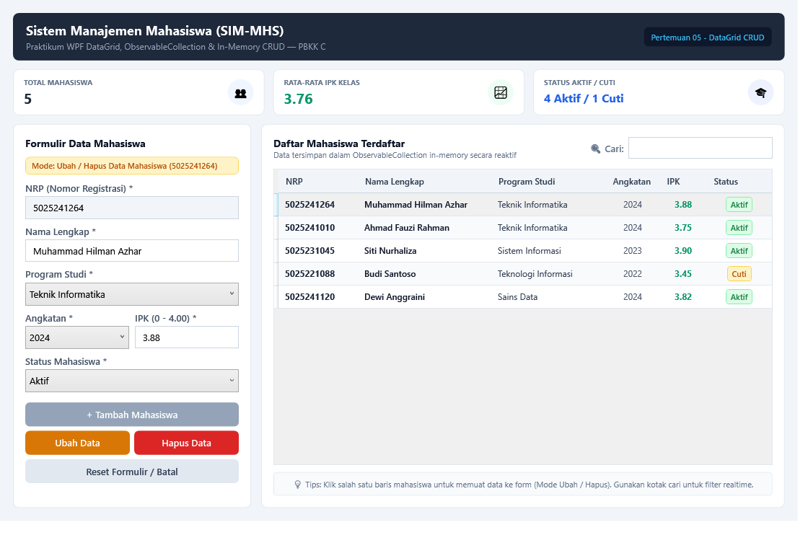

# Pertemuan 05: Pendalaman WPF - Student Management System (DataGrid CRUD)

Implementasi aplikasi desktop manajemen data mahasiswa berbasis Windows Presentation Foundation (WPF), C#, dan `DataGrid` in-memory untuk tugas Pertemuan 05 mata kuliah Pemrograman Berbasis Kerangka Kerja (PBKK) C.

## Identitas
- **Nama:** Muhammad Hilman Azhar
- **NRP:** 5025241264
- **Kelas:** PBKK C
- **Dosen Pengampu:** Fajar Baskoro, S.Kom., M.T.
- **Laporan Notion:** [Buka Laporan di Notion](https://app.notion.com/p/Pertemuan-5-WPF-DataGrid-In-Memory-Student-Management-4009c0720c5a81cea4c2d2ba2f102787)

## Deskripsi Singkat
Aplikasi Sistem Informasi Manajemen Mahasiswa (SIM-MHS) menyajikan arsitektur dashboard modern yang menghubungkan formulir input dengan tabel data reaktif:
1. **Pemanfaatan Komponen DataGrid:**
   - Menampilkan data tabular terstruktur dengan kolom NRP, Nama Lengkap, Program Studi, Angkatan, IPK, dan Status.
   - Menggunakan `DataGridTemplateColumn` untuk menampilkan badge status berwarna dinamis (Hijau untuk Aktif, Kuning untuk Cuti).
   - Pengaturan baris berselang (*alternating row background*) dan seleksi baris tunggal (*Single Row Selection*).
2. **Koleksi Data Reaktif (`ObservableCollection<T>` & `INotifyPropertyChanged`):**
   - Data disimpan dalam koleksi `ObservableCollection<Mahasiswa>` sehingga penambahan dan penghapusan item langsung memperbarui tabel secara otomatis tanpa perlu rebind manual.
   - Model `Mahasiswa` mengimplementasikan `INotifyPropertyChanged` untuk sinkronisasi nilai properti saat diedit.
3. **Operasi CRUD Lengkap:**
   - **Create:** Menambah data mahasiswa baru dengan validasi format NRP unik, minimal panjang nama, dan rentang nilai IPK (0.00 - 4.00).
   - **Read:** Menampilkan seluruh koleksi data dan mendukung pencarian / *filtering* teks secara *real-time* via `ICollectionView`.
   - **Update:** Memilih baris data pada tabel otomatis memuat data ke formulir, mengunci NRP (*read-only*), serta mengaktifkan tombol Ubah Data.
   - **Delete:** Menghapus data mahasiswa terpilih melalui tombol Hapus Data dengan dialog konfirmasi keamanan.
4. **Kartu Metrik & Statistik (KPI Cards):**
   - Ringkasan realtime jumlah total mahasiswa terdaftar, rata-rata IPK kelas, serta rasio mahasiswa aktif/cuti.

## Struktur Berkas
- `Models/Mahasiswa.cs`: Definisi model entitas data mahasiswa dengan implementasi `INotifyPropertyChanged`.
- `MainWindow.xaml`: Desain antarmuka visual dashboard (kartu statistik, formulir aksi, dan DataGrid).
- `MainWindow.xaml.cs`: Logika event handler CRUD, filter pencarian, dan kalkulasi ringkasan metrik.
- `Pertemuan-05-WPF-Student-Management.csproj`: Konfigurasi proyek WPF berbasis .NET 10.0.
- `screenshots/student_management_gui.png`: Tangkapan layar bukti eksekusi program.

## Cara Menjalankan
Pastikan .NET SDK (versi 8.0 / 10.0) telah terinstal di Windows.

```bash
dotnet run
```

## Hasil Eksekusi
Tampilan jendela dashboard aplikasi manajemen mahasiswa WPF saat berjalan:


